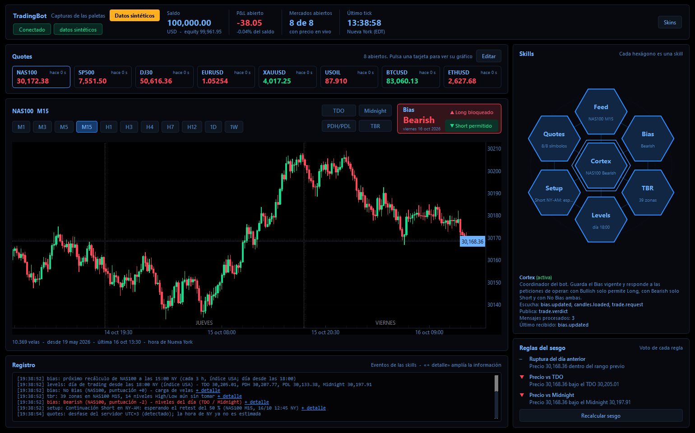
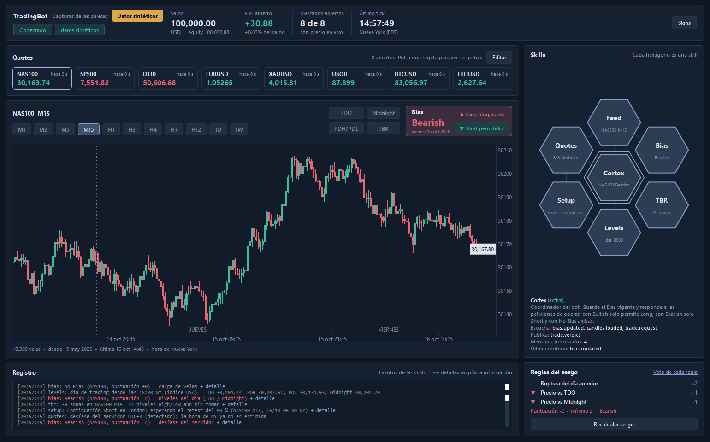
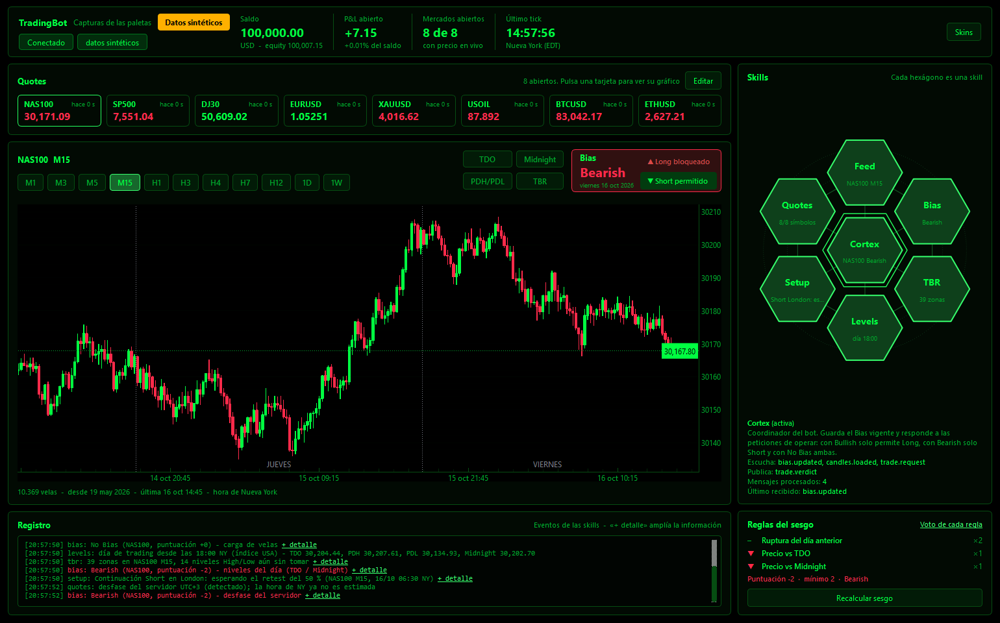
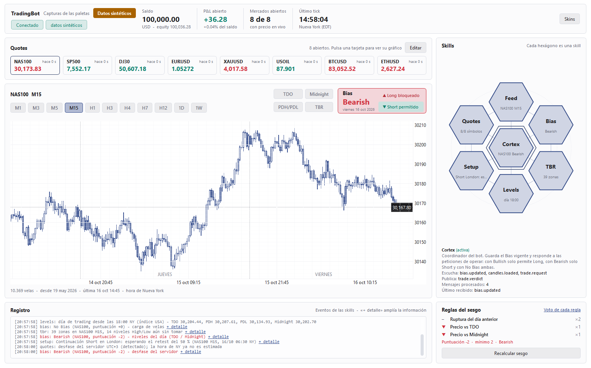

# TradingBot

Bot de trading con interfaz gráfica sobre MetaTrader 5. Esta primera versión incluye dos tareas y **no opera**:
no existe ninguna llamada para enviar órdenes, solo lectura de datos.

La interfaz sigue el estilo de la referencia visual: azul pizarra oscuro, paneles planos con borde fino,
tarjetas de mercado, gráfico de velas verde azulado/coral y, a la derecha, el sesgo del día.

| Tarea | Qué hace |
|---|---|
| Conexión y velas | Conecta con MT5 usando la cuenta del `.env` y carga todas las velas posibles en 1m, 3m, 5m o 15m (por defecto 15m). |
| Bias | Evalúa las reglas y decide el sesgo del día: **Bullish**, **Bearish** o **No Bias**. Se muestra en un recuadro compacto en la cabecera del gráfico, a la derecha de los botones TDO, Midnight, PDH/PDL y TBR (en una matriz 2x2). |

### Patrones, coordinación y ejecución (skills Pattern, Cortex y Setup)

Con las tres TBR de trabajo (Asia, London, NY Open), la **TBR activa** es la última que ha cerrado: nos deja fijados su High, su
Low y su 50 %. Cada skill tiene un papel:

- **Pattern** se conecta a TBR, toma la TBR activa y busca en ella los **patrones de entrada** (`@register_pattern`), hasta
  que acaba el plazo de cada TBR (`PATTERN_UNTIL`): Asia hasta el final de London (05:00 NY, 5 h tras cerrar), London hasta el final de NY Open (12:00, 7 h) y NY Open hasta las 18:00 (6 h). Si el plazo se corta por tiempo con el setup ya formado (fibo trazado y sin entrada), Cortex lo anota como NO GO con etiqueta **T** (tiempo). Si el setup se invalida con el fibo ya formado (el precio supera la mecha pivote, pierde el swing low o una vela cierra fuera antes de la entrada), Cortex lo anota NO GO con etiqueta **I** (invalidado) y el gráfico dibuja ese fibo atenuado hasta la vela que lo invalida, con «I · invalidado»; la T se dibuja igual con «T · tiempo».
  Cada patrón identificado se anota en el Registro, igual que los que se invalidan, se anulan o vencen, con su motivo. Tras
  NY PM (16:30 NY) no se evalúan más setups y también se anota. Solo usa velas cerradas. Hoy hay dos patrones (ver abajo).
- **Cortex** (el coordinador) reúne el activo, la temporalidad, el sesgo, la TBR y el patrón. Contrasta el patrón con las reglas
  del Bias: a favor del sesgo (Bullish solo Long, Bearish solo Short) es **GO**; en contra, sin sesgo o con el mercado lateral,
  **NO GO**. El Registro anota los dos resultados con su motivo. Con GO, Cortex le pasa a Setup la orden completa (activo,
  temporalidad, dirección, sesgo, TBR, patrón y, si el patrón los define, stop y objetivo). `CORTEX_ALLOW_NO_BIAS=true` da GO
  también sin sesgo.
- **Setup** es solo el **ejecutor** en la cuenta del broker: únicamente escucha a Cortex (`setup.order`) y no decide nada.
  **Por ahora funciona en modo simulación:** prepara la orden y la anota en el Registro, pero no la envía a MT5
  (`SETUP_SEND_ORDERS=true` da error hasta que se implemente el envío real). El bot sigue sin enviar órdenes a MT5.

#### Todos los mercados, aunque no estén en pantalla (barrido de la watchlist)

El gráfico solo carga el mercado que pinchas, pero el bot evalúa **todos los mercados del panel Quotes**: la skill Feed los
barre en segundo plano cada `FEED_SWEEP_MINUTES` minutos (5; `0` lo apaga), en el timeframe de trabajo
(`FEED_SWEEP_TIMEFRAME`, vacío = el de `FEED_TIMEFRAME`) y con los últimos `FEED_SWEEP_DAYS` días de velas (10). El primer
barrido se hace nada más conectar, y la lista se actualiza al editar la watchlist. Así Pattern, Cortex y Setup buscan
patrones, deciden GO / NO GO y siguen las posiciones simuladas de cada mercado, y el forwardtest (Stats) recoge las
operaciones de todos.

- Las velas del barrido van marcadas como `background` y la ventana no las pinta: **el gráfico sigue con su mercado en
  directo** (añade cada vela nueva, como siempre) y el barrido no le cambia el mercado, el sesgo, las TBR ni los niveles
  que se ven. Los patrones, los GO / NO GO y las operaciones de cualquier mercado sí se anotan en el Registro.
- **Desde el inicio del forwardtest** (`STATS_FORWARD_START`, 2026-10-19) Pattern avisa de los patrones de **todas** las
  TBR cerradas, no solo de la última de cada zona: así Cortex decide y Setup simula también lo que pasó con el bot cerrado,
  y la ventana Forwardtest suma y lista (diario de operaciones) todas las operaciones de todos los mercados desde ese día.
  Lo ya anotado no se repite. El barrido llega hasta `FEED_SWEEP_DAYS` días atrás (y el gráfico, hasta `TBR_DAYS`).
- Bias calcula el sesgo de cada mercado del barrido con sus propios TDO y Midnight (ajustes `LEVELS_DAY_START`,
  `LEVELS_INDEX_DAY_START` y `LEVELS_US_INDICES`) y Cortex valida cada patrón con el sesgo **de su mercado**.
- **Cierre por tiempo.** Un trade de patrón abierto se cierra solo al fin del día de trading (17:00 NY en forex y metales, `LEVELS_DAY_START`; 18:00 en los índices USA, `LEVELS_INDEX_DAY_START`), y como tope 24 h tras la entrada. Los de Calendario cierran a `CALENDARIO_EXIT_HOUR`.
- **Mercado cerrado.** Si el mercado cierra con una operación abierta (más de 2 h sin velas: fin de semana o festivo; el parón diario de 1 h no cuenta), se cierra al precio de cierre de su última vela.
- **Posiciones.** Con `CORTEX_POSITION_SCOPE=mercado` (por defecto) cada mercado opera independiente de los demás, pero
  nunca hay dos operaciones abiertas a la vez en el mismo mercado; con `global`, una sola en toda la cuenta.
- **Orden de las decisiones.** Dentro de un mercado (y, con `CORTEX_POSITION_SCOPE=global`, entre todos) importa quién llega
  primero. Por eso, mientras dura una vuelta del barrido, Cortex **retiene** los patrones (también los del gráfico) y, cuando
  Pattern y Bias han repasado todos los mercados cargados, los decide juntos **en orden de hora**: un patrón de las 09:00 de
  un mercado va antes que uno de las 10:00 de otro aunque llegue después. Si una vuelta no se completa, Cortex decide igualmente
  un minuto después de que termine la carga (15 minutos como mucho por vuelta). Entre una vuelta y otra, lo que llega en
  directo del gráfico se decide al momento.

Se configuran en los bloques **PATTERN** (`PATTERN_TYPES`, `PATTERN_ZONES`, `PATTERN_ZONE_ORDER`), **CORTEX**
(`CORTEX_ALLOW_NO_BIAS`) y **SETUP** (`SETUP_SEND_ORDERS`) de `tradingbot.env`. El antiguo setup de continuación (toma de
liquidez, retest del 50 %, segunda ruptura) se retiró de la skill Setup; su código y sus resultados se conservan solo para el
análisis histórico (`scripts/setups_continuacion.py`, `docs/analisis_setups`).

#### Patrón «Continuación» (`continuacion`)

Ejemplo alcista; el bajista es el espejo exacto. Trabaja siempre con velas de `PATTERN_CONTINUACION_TF` (M15 al inicio): el gráfico
puede estar en M15 o en un timeframe menor que lo divida (M1, M3, M5 se agrupan en M15); si no, el Registro lo avisa.

1. **Rotura con cuerpo:** una vela de M15 **cierra** por encima del High de la TBR (o por debajo del Low). Una mecha sola no activa
   la TBR. Se evalúa la última TBR cerrada de cada zona (Asia, London, NY Open) mientras dura su plazo; las que no se han activado
   no dejan nada, y no se usan TBR de hace más de un día. Si antes de la rotura una vela ya había tomado ese mismo lado
   solo con la mecha (cerrando dentro), el lado es de Reversión y la Continuación no se da.
2. **Swing high (el 0):** el primer pivote alto tras la rotura (`PATTERN_CONTINUACION_SWING_BARS` velas de cada lado, 1 al inicio: el
   patrón de tres velas). Un swing high más alto, antes de la entrada, sustituye al 0. En la rotura bajista, al revés (swing low).
3. **Swing low previo (el 1, el stop):** un pivote que **ya existe, a la izquierda del 0**; el fibo va del 1 al 0 y, como el stop ya está
   formado, la entrada no espera a ningún swing posterior. Dos casos, los dos disparan a Cortex: **A. Ideal** si es el último swing
   low formado desde que cerró la TBR con el precio **dentro del rango de la TBR**; **B. Flexible** si no hay ninguno, el primer swing
   low tras la rotura (fuera del rango). La orden, el diario del forwardtest y el Registro anotan de qué caso se trata, el diario de
   operaciones lo muestra junto al patrón («Continuación · A. Ideal») y la ventana Forwardtest suma un libro «Continuación por caso».
4. **Fibonacci del tramo** (botón **Fibo** del gráfico, activo por defecto): del swing low previo (1) al swing high (0), con el **0,5**
   como punto medio. El tramo queda fijo y dibuja el stop y el objetivo configurados (`PATTERN_STOP_LEVEL` / `PATTERN_TARGET_LEVEL`).
5. **Entrada:** la primera vela **posterior a la que confirma el swing high del 0** que retrocede hasta el 0,5 (su mínimo lo toca) y
   abre por encima de él (viene del lado del 0; en la rotura bajista, al revés). Si pierde el 1 antes de entrar, el patrón se invalida
   (NO GO «I»); si el plazo de la TBR termina sin retroceso al 0,5, vence (NO GO «T»).

Solo se trata el fibonacci en curso; stop y objetivo viajan en la orden que Cortex le pasa a Setup (en simulación).

**Entradas** (botón **Entradas**, bajo Fibo; activo por defecto): cada entrada de un patrón se dibuja como la herramienta de posición
de TradingView: zona **verde** desde la entrada hasta el objetivo, zona **roja** hasta el stop, línea de entrada y etiquetas con el
precio del objetivo y del stop, el R:R y el estado (objetivo, stop o abierta). La zona llega hasta la vela en que se alcanzó el
objetivo o el stop (si caben los dos en la misma vela, cuenta el stop) o hasta la última vela si sigue abierta. Valen para largos y
cortos. `PATTERN_SHOW_POSITIONS=false` lo deja apagado al arrancar.

#### Patrón «Reversión» (`reversion`)

Ejemplo bajista; el alcista es el espejo exacto. También trabaja siempre con velas de M15 (`PATTERN_REVERSION_TF`).

1. **Toma con mecha:** una vela de M15 supera el High de la TBR con su mecha pero **cierra dentro** del rango (con el Low, para el
   alcista). Si cerrara fuera sería una rotura con cuerpo y la TBR es del patrón Continuación. Se evalúa la primera toma de un lado.
2. **Mecha pivote:** el pivote de tres velas que forma esa mecha (su máximo es el más alto de las tres). Si antes de confirmarse
   una vela cierra por encima del High, el patrón se invalida.
3. **Fibonacci** (mismo botón **Fibo**, con el título «Rev»): el **1** es la mecha pivote y el **0** el primer pivote bajo confirmado que
   genera a continuación (queda fijo: uno posterior más bajo no lo sustituye); 0,5 y -0,5 como en Continuación.
4. **Entrada** en el 0,5 (la primera vela que revierte hasta ahí, después de la vela que confirma el pivote del 0 —no se puede
   entrar en el propio swing que aún se está formando— y abriendo por encima del 0,5 en el largo, por debajo en el corto), **stop** en la mecha pivote (el 1) y **objetivo** en el -0,5: **2R**.
   Si el precio supera la mecha pivote antes de la entrada, el patrón se invalida; si el plazo de la TBR termina sin reversión al 0,5,
   vence. Ambos patrones pueden dar señal en la misma TBR: Cortex las valida con el sesgo.

Cabecera: estado de la conexión y cuenta; a continuación, saldo/equity, P&L abierto, mercados con precio en vivo y hora del último tick
**en hora de Nueva York**. MT5 entrega los ticks en la hora del servidor de tu broker; el bot mide el desfase de ese
servidor comparando los ticks en vivo con el reloj de tu PC (unos segundos tras conectar) y convierte a Nueva York
respetando el cambio de horario de EE. UU. Hasta que lo mide, la hora se marca como *(estimada)* y asume servidor = Nueva York + 7 h.
Pasa el ratón sobre la caja para ver la hora del servidor y el desfase detectado. Si no lo detecta bien (PC desincronizado),
fíjalo a mano con `QUOTES_SERVER_UTC_OFFSET` en `tradingbot.env`. El eje de tiempo del gráfico también va en hora de
Nueva York (hasta medir el desfase, estimada; lo indica la línea bajo el gráfico).

Panel **Quotes** (antes *Mercados*): cotizaciones de solo lectura (se refrescan cada segundo; se cambia con `QUOTES_INTERVAL`). Con el botón **Editar** del panel eliges
qué mercados se muestran: busca entre los símbolos reales de tu broker (también por nombre común: *dow*, *nasdaq*,
*oro*, *petróleo*, *bitcoin*...), añade, quita y reordena. Se aplica al instante y se guarda en `settings.local.json`
(no se sube a git), que tiene prioridad sobre la `watchlist` de `config.toml`. Borrar ese fichero devuelve la lista de `config.toml`.
Cada perfil guarda su lista; uno que aún no tiene la suya usa la común (la de antes de los perfiles).
Pulsa una tarjeta para cargar su gráfico. Un símbolo cuyo último tick va más de 5 minutos por detrás del más
reciente se marca como *Mercado cerrado*, y uno que el broker no tiene aparece como *No disponible*.
Usa los nombres exactos de tu broker (en MT5: Ver > Símbolos).

Pinchar una tarjeta carga su gráfico (no hay selector de símbolo ni botón de cargar): para ver un símbolo nuevo,
añádelo primero con **Editar**. Si quitas el mercado que estás viendo, el gráfico carga el primero de la lista.

**Ejes del gráfico**: se redimensionan arrastrándolos con el ratón, como en TradingView.
- Eje de precio (derecha): arrastrar hacia abajo comprime el precio y hacia arriba lo estira. Al tocarlo, el precio
  deja de ajustarse solo y el gráfico también se puede mover en vertical.
- Eje de tiempo (abajo): arrastrar a la izquierda muestra más velas y a la derecha menos, sin mover la vela más reciente.
- Doble clic en un eje: vuelve a la escala automática (en el de tiempo, también a las últimas 220 velas).

**Timeframes** (chips sobre el gráfico): M1, M3, M5, M15, H1, H3, H4, H7, H12, 1D y 1W. Cambiar de timeframe recarga el mercado actual.
- MT5 no tiene H7 (solo H1, H2, H3, H4, H6, H8 y H12). H7 se construye agrupando velas de 1 hora, alineadas con la
  medianoche de cada día (hora del servidor): 00-07, 07-14, 14-21 y 21-24, esta última más corta (3 horas).
- Con velas semanales (1W) el sesgo no se recalcula, porque "el día" no existe en ese timeframe: se conserva el último.

**TBR** (botón junto al título del gráfico): marca en el gráfico las zonas horarias del día, todas en hora de Nueva York.
Cada zona es una caja que va de su inicio a su final y de su Low a su High, con su color muy transparente para que se
sigan viendo las velas:

| Zona | Horario (NY) | Color |
|---|---|---|
| Asia | 20:00 - 00:00 | amarillo |
| London | 02:00 - 05:00 | rojo |
| NY Open | 10:00 - 12:00 | verde |

Las zonas Pre-NY (RHT, 09:00 - 10:00, gris) y NY-PM (13:30 - 16:30, morado) se han quitado por ahora para simplificar la
estrategia; siguen definidas en `tradingbot.env` y se recuperan añadiendo `PRE_NY` / `NY_PM` a `TBR_ZONES`.

Para cada zona ya terminada dibuja tres niveles con su color: **High** y **Low** (línea continua) y **50 %** (punteada).
Cada nivel sale del borde derecho de la caja y se prolonga hasta la primera vela posterior que lo toca o lo atraviesa;
si ninguna lo ha tomado todavía, llega hasta el borde derecho del gráfico. Una zona en curso se pinta con el rango que
lleva hasta el momento; sus niveles aparecen al terminar.
- Horarios, colores, nombres, opacidad y días hacia atrás se cambian en el bloque **TBR** de `tradingbot.env`, donde
  también se pueden añadir zonas nuevas.
- Las velas llegan en hora del servidor del broker; las zonas se colocan con el desfase que mide Quotes (hasta medirlo
  se asume servidor = Nueva York + 7 h, lo habitual en Vantage).
- Solo se dibujan hasta H1 (`TBR_MAX_TF_MINUTES`): con velas más grandes las franjas no caben y el botón se desactiva.
  Con H1, la zona 13:30-16:30 incluye las velas que se solapan con ella (de 13:00 a 16:00).

**Niveles del día** (botones **TDO**, **Midnight** y **PDH/PDL**, junto a TBR). El día de trading empieza a una hora de
Nueva York que depende del activo: a las **18:00 en los índices americanos** (NAS100, SP500, DJ30...) y a las **17:00 en
el resto** (forex, metales, cripto...). Lleva el nombre del día en que termina: el que empieza el martes a las 17:00 es
el MIÉRCOLES. Las horas y la lista de índices se cambian en el bloque LEVELS de `tradingbot.env`:

| Botón | Nivel | Línea |
|---|---|---|
| TDO | True Day Open: precio de apertura de la primera vela del día de trading (18:00 / 17:00 NY) | gris, discontinua |
| Midnight | Precio de apertura de la vela de las 00:00 de Nueva York | naranja, punteada |
| PDH/PDL | Máximo y mínimo del día de trading anterior (Previous Day High / Low) | azul, discontinua |

Cada nivel se dibuja desde su vela hasta el final de su día, con su nombre al final de la línea; los del día en curso
pasan un poco de la última vela. Además, una **línea vertical punteada** marca el inicio de cada día de trading, y el
nombre del día (LUNES, MARTES...) va abajo, centrado entre su separador y el siguiente. Todo se configura en el bloque **LEVELS** de `tradingbot.env` (botones activados al arrancar,
colores, días hacia atrás, separadores). Con velas diarias o semanales no se dibujan y los botones se desactivan.
**Histograma del sesgo** (botón **Sesgo**, bajo SMA): una barra por vela del timeframe visible con la puntuación que habría
tenido el Bias (suma de voto x peso de las reglas activas), bajo el gráfico de precio como el volumen de TradingView. Verde:
sesgo alcista; rojo: bajista; gris: sin sesgo; las líneas discontinuas marcan el umbral. Se reconstruye sin mirar al
futuro y se congela en cada vela HTF (3 h en índices, 4 h en el resto), como el bot en vivo. Soporta las reglas
`prev_day_break`, `tdo` (y `above_below_open`), `midnight`, `htf_sweep`, `htf_break` y `sma`.

El histograma es **interactivo**: al pulsar una barra se marca esa vela (línea vertical en el histograma y en el gráfico) y el
panel **Reglas del sesgo** muestra el voto, el peso y los puntos de cada regla activa en esa vela, con su fecha y hora de NY junto
al título. Sin ninguna vela marcada (o con el histograma apagado) muestra la vela actual (`TF=M15 · Vela actual`). Se desmarca con
el clic derecho o volviendo a pulsar la misma barra. En las velas pasadas solo hay voto y peso (no los precios de cada regla).

**Avisos en el Registro:** la skill Levels anota el cierre de mercados (futuros de índices USA cada día laborable, Forex el
viernes; `LEVELS_MARKET_CLOSE`) y el cambio de día de trading de cada activo a su hora: 18:00 NY en los índices
americanos y 17:00 NY en el resto, con los activos de tu lista de Quotes que corresponden. De domingo a jueves.

**SMA** (botón a la izquierda de TDO): media móvil simple de los cierres, de 30 periodos por defecto, calculada con las velas del
timeframe que se está viendo. Con el botón de la **rueda dentada** de al lado (o clic derecho en el botón) se abre su ventana: periodos, color de la línea y trazo
(normal, discontinuo o punteado); se aplica al momento y se guarda en el bloque LEVELS de `tradingbot.env`.

Estos niveles sustituyen a las líneas fijas *Máx. previo*, *Mín. previo* y *Apertura* que antes pintaba el Bias
(el Bias sigue usando el día del servidor del broker en sus reglas).

Filtro de operativa: con **Bullish** solo se permiten operaciones alcistas (Long), con **Bearish** solo bajistas (Short), y con **No Bias** ambas. La futura capa de ejecución debe consultar `TradeFilter.check(direction)` antes de abrir cualquier trade.


#### Patrón «Doble barrido TBR» (`doble_barrido`)

Solo en NY Open, con velas de M5 (`PATTERN_DOBLE_BARRIDO_TF`). **Apagado por defecto**: con `PATTERN_TYPES` vacío el bot no lo busca ni Cortex lo ve; se activa escribiendo `doble_barrido` en `PATTERN_TYPES`. Se valida en backtest con `scripts/backtest_doble_barrido.py`. Ejemplo bajista; el alcista es el espejo exacto, con los Low.

1. **Toma con cuerpo:** una vela cierra por encima de los High de Asia y London (basta cerrar sobre el más alto; el orden da igual), cruzándolos, desde el cierre de la última de las dos TBR hasta el cierre de la TBR de NY Open. Puede ocurrir antes de que empiece NY Open.
2. **Swing high:** el máximo absoluto del barrido hasta el paso 3.
3. **Confirmación:** una vela pasa por debajo de los dos High (basta la mecha).
4. **Entrada:** retesteo del High de Asia (`PATTERN_DOBLE_BARRIDO_ENTRY`: `asia`, `extremo` o `primero`; basta la mecha), desde el inicio de NY Open. Si antes de entrar el precio supera el swing, el barrido sigue en marcha y se reinicia desde ahí; pasado el cierre de NY Open, el setup se invalida. Stop en el 0,618 del fibonacci del nivel (0) al swing (1) (`PATTERN_DOBLE_BARRIDO_STOP_FIB`; 1 = el propio swing); objetivo en el Low más bajo entre Asia y London. Con la posición a +1 R (`SETUP_BE_TRIGGER_PCT` / `SETUP_RISK_PCT`) el stop pasa a la entrada en cuanto el precio toca ese nivel.

Un solo trade al día: si los dos lados dan entrada, cuenta la primera. Se busca hasta el cierre del día de trading.

## Requisitos

- Windows con MetaTrader 5 instalado, abierto y con la cuenta iniciada.
- [uv](https://docs.astral.sh/uv/) (`winget install astral-sh.uv`). Descarga Python 3.12 y las dependencias solo.

## Arranque

```powershell
cd C:\Users\claude\DEV\TradingBot
.\scripts\run.ps1              # cuenta por defecto del .env
.\scripts\run.ps1 --demo       # datos sintéticos: la interfaz funciona sin MT5
.\scripts\run.ps1 --profile real
```

Opciones: `--profile`, `--env RUTA`, `--symbol EURUSD`, `--timeframe 5m`, `--theme blanco`, `--demo` / `--no-demo`.
Mandan sobre `tradingbot.env` solo para esa vez (por ejemplo, `--no-demo` conecta con MT5 aunque `APP_DEMO=true`).

`run.ps1` hace, por este orden:
1. Lee `tradingbot.env` (ver abajo) y pasa sus valores a la app.
2. Si `APP_AUTO_UPDATE=true`, trae de GitHub el código nuevo (`git pull`) antes de arrancar.
3. Arranca la app con `uv`.

## Configuración (tradingbot.env)

`tradingbot.env`, en la raíz del proyecto, gobierna el arranque y las skills. Es texto `CLAVE=valor`, organizado
en bloques comentados, uno por skill o parte del bot. Cada clave empieza por el nombre de su bloque:

| Clave | Por defecto | Para qué |
|---|---|---|
| **APP** — arranque | | |
| `APP_AUTO_UPDATE` | `false` | Traer el código nuevo de GitHub (`git pull`) antes de arrancar (`true`/`false`). Lo lee `run.ps1`. |
| `APP_PROFILE` | vacío | Perfil de MT5 con el que conectar: el `<NOMBRE>` de `MT5_<NOMBRE>_LOGIN` del `.env` de cuentas. Vacío: el de `MT5_DEFAULT`. El último perfil elegido en el selector de la cabecera manda sobre esta clave. |
| `APP_DEMO` | `false` | `true`: datos sintéticos, sin conectar con MT5 (como `--demo`). |
| **FEED** — conexión y velas | | |
| `FEED_SYMBOL` | `NAS100` | Mercado que se carga al arrancar. Nombre exacto del broker, con mayúsculas y sufijos (`NAS100FT.r`). |
| `FEED_TIMEFRAME` | `M15` | Timeframe al arrancar: `M1` `M3` `M5` `M15` `H1` `H3` `H4` `H7` `H12` `1D` `1W` (también vale `15m`, `1h`...). |
| `FEED_MAX_BARS` | `20000` | Velas que se cargan de cada mercado y timeframe (las más recientes), en todos los perfiles. Pocas = cambio de mercado ágil. |
| `FEED_SWEEP_MINUTES` | `5` | Minutos entre vueltas del barrido en segundo plano de toda la watchlist (`0` = sin barrido). Ver «Todos los mercados, aunque no estén en pantalla». |
| `FEED_SWEEP_TIMEFRAME` | *(vacío)* | Timeframe del barrido; vacío = el de `FEED_TIMEFRAME`. |
| `FEED_SWEEP_DAYS` | `10` | Días de velas que se cargan de cada mercado en cada vuelta del barrido. |
| **QUOTES** — cotizaciones y cuenta | | |
| `QUOTES_INTERVAL` | `1` | Segundos entre refrescos del panel Quotes y de las cifras de la cuenta (admite decimales). |
| `QUOTES_SERVER_UTC_OFFSET` | vacío | Desfase del servidor del broker respecto a UTC, en horas. Vacío: se detecta solo con los ticks en vivo. |
| **BIAS** — sesgo del día | | |
| `BIAS_RULES` | `prev_day_break, tdo, midnight, htf_break` | Reglas activas, separadas por comas (`prev_day_break`, `tdo`, `midnight`, `htf_break`, `htf_sweep`, `sma`, `above_below_open`). `ninguna`: sin reglas (siempre No Bias). |
| `BIAS_MIN_SCORE` | `3` | Umbral: puntuación mínima (suma de voto x peso) para que haya sesgo (`+3` Bullish, `-3` Bearish). |
| `BIAS_LATERAL_HOURS` / `BIAS_LATERAL_MIN_EFFICIENCY` | `6` / `0.15` | Filtro de lateralidad: sin sesgo si en las últimas horas el precio avanzó menos de esa fracción de su recorrido (`0`: sin filtro). |
| `BIAS_RECALC_INDEX_HOURS` / `BIAS_RECALC_HOURS` | `3` / `4` | Cada cuántas horas se recalcula el sesgo solo, alineado con el inicio del día de trading: índices USA / resto. `0`: desactivado. |
| `BIAS_<REGLA>_WEIGHT` | `2` ruptura / `1` apertura | Peso de cada regla en la puntuación. |
| `BIAS_REQUIRE_ALL` | `false` | `true`: solo hay sesgo si todas las reglas activas votan lo mismo. |
| `BIAS_<REGLA>_<PARÁMETRO>` | — | Parámetros de cada regla, p. ej. `BIAS_ABOVE_BELOW_OPEN_TOLERANCE_PCT=0.1`. |
| **TBR** — zonas horarias del botón TBR | | |
| `TBR_SHOW` | `false` | Botón TBR activado al arrancar. |
| `TBR_DAYS` | `10` | Días naturales hacia atrás que se dibujan. |
| `TBR_OPACITY` | `12` | Opacidad del relleno de las zonas, en % (0 invisible, 100 opaco); valores bajos dan el efecto traslúcido. |
| `TBR_LINE_OPACITY` | `60` | Opacidad de las líneas High, Low y 50 % de las zonas, en % (0-100). |
| `TBR_MAX_TF_MINUTES` | `60` | Timeframe máximo (en minutos) con el que se dibujan. |
| `TBR_ZONES` | `ASIA, LONDON, NY_AM` | Zonas activas y su orden. |
| `TBR_<ZONA>_NAME` / `_HOURS` / `_COLOR` | ver tabla de TBR | Nombre, horario NY (`HH:MM-HH:MM`; si acaba antes de empezar, termina al día siguiente) y color `#RRGGBB` de cada zona. |
| **LEVELS** — niveles del día y separadores | | |
| `LEVELS_SHOW_TDO` / `_SHOW_MIDNIGHT` / `_SHOW_PDHL` | `false` | Botones TDO, Midnight y PDH/PDL activados al arrancar. |
| `LEVELS_INDEX_DAY_START` / `LEVELS_DAY_START` | `18:00` / `17:00` | Inicio del día de trading (separador y TDO), en hora de NY: índices americanos / resto de activos. |
| `LEVELS_US_INDICES` | `NAS100, SP500, DJ30, US30, US100, US500, USTEC, US2000, SPX500, NDX100` | Inicios de nombre que cuentan como índice americano (sin distinguir mayúsculas; `NAS100` vale para `NAS100.r`). |
| `LEVELS_SHOW_SMA` | `false` | Botón SMA activado al arrancar. |
| `LEVELS_SMA_PERIOD` / `_SMA_COLOR` / `_SMA_STYLE` | `30` / `#00ACC1` / `normal` | Periodos, color `#RRGGBB` y trazo (`normal`, `discontinuo`, `punteado`) de la SMA. |
| `LEVELS_MARKET_CLOSE` | `17:00` | Hora de NY del cierre de mercados: el Registro avisa cuando cierran los futuros de índices USA (cada día laborable) y Forex (cierre semanal, el viernes). |
| `LEVELS_SEPARATORS` | `true` | Líneas verticales punteadas entre días, con su nombre centrado. |
| `LEVELS_DAYS` | `10` | Días de trading hacia atrás que llevan niveles. |
| `LEVELS_MAX_TF_MINUTES` | `720` | Timeframe máximo (en minutos) con el que se dibujan (hasta H12). |
| **PATTERN** — patrones dentro de la TBR activa | | |
| `PATTERN_TYPES` | vacío | Claves de los patrones que se buscan. Vacío: todos los definidos (`continuacion` y `reversion`). |
| `PATTERN_ZONES` | vacío | Claves de las TBR en las que se buscan (p. ej. `LONDON, NY_AM`). Vacío: todas. |
| `PATTERN_SHOW_POSITIONS` | `true` | Botón «Entradas» del gráfico activado al arrancar. |
| `PATTERN_SHOW_FIBO` | `true` | Botón «Fibo» del gráfico activado al arrancar. |
| `PATTERN_CONTINUACION_TF` | `15m` | Timeframe del patrón Continuación (el gráfico, en ese timeframe o uno menor que lo divida). |
| `PATTERN_CONTINUACION_SWING_BARS` | `1` | Velas a cada lado que definen un swing (pivote): 1 = patrón de tres velas. |
| `PATTERN_REVERSION_TF` / `PATTERN_REVERSION_SWING_BARS` | `15m` / `1` | Timeframe y velas por lado del pivote del patrón Reversión. |
| `PATTERN_STOP_LEVEL` / `PATTERN_TARGET_LEVEL` | `1` / `-0.2` | Niveles del fibo donde van el stop y el objetivo de Continuación y Reversión (entrada en el 0,5). El fibo del gráfico dibuja esos niveles (el objetivo en rojo). Con 1 y -0,2 el RR es 1:1,4: en el backtest 2018-2026 (8 mercados, con spread) da +0,16 R por operación frente a +0,08 R del -0,5 (RR 1:2); acortar el stop a 0,9 o 0,8 empeora el resultado. |
| `PATTERN_ZONE_ORDER` | `ASIA, LONDON, NY_AM, NY_PM` | Ciclo de TBR en orden: cada patrón se busca hasta que empieza la TBR siguiente. NY PM solo marca el límite de NY Open. |
| **CORTEX** — coordinador | | |
| `CORTEX_ALLOW_NO_BIAS` | `false` | `true`: con No Bias también se da GO al patrón identificado. |
| **SETUP** — ejecutor | | |
| `SETUP_SEND_ORDERS` | `false` | Enviar las órdenes de Cortex a MT5. Aún no implementado: `true` da error; ahora solo se simulan. |
| `SETUP_RISK_PCT` | `1` | Riesgo de cada operación simulada, en % del saldo virtual del perfil (resultado en dinero = R x riesgo). |
| `SETUP_BE_TRIGGER_PCT` | `1` | Ganancia flotante, en % del saldo, que al cierre de una vela de 15 min pasa el stop a la entrada (breakeven). `0`: sin breakeven. |
| `SETUP_CONSOLIDATE_INDEX_HOURS` / `SETUP_CONSOLIDATE_HOURS` | `3` / `4` | Las cerradas del Forwardtest pasan al saldo virtual del perfil al terminar la vela de estas horas (índices USA / resto) en la que cerraron. Deben dividir el día. |
| `LEVELS_TDO_COLOR` / `_MIDNIGHT_COLOR` / `_PDHL_COLOR` / `_SEPARATOR_COLOR` | `#787B86` / `#FF9800` / `#2962FF` / `#787B86` | Colores `#RRGGBB`. |
| **UI** — interfaz | | |
| `UI_THEME` | `matrix` | Paleta de arranque: `matrix`, `negro`, `pizarra` o `blanco`. |
| `UI_FONT` | `mockup` | Tipo de letra: `mockup` (Inter con trazo medio, la de la propuesta de diseño; sin Inter, Segoe UI con los mismos pesos) o `clasica` (Segoe UI con negritas). Las `.ttf` de `tradingbot/ui/fonts` se cargan al arrancar. |

Cada clave lleva en `tradingbot.env` un comentario que la explica, con su valor por defecto entre paréntesis.
Una clave vacía, comentada o borrada usa el valor por defecto, que vive en el código (`tradingbot/config.py` y cada skill).
Las opciones no usadas se dejan comentadas con `#`, así cambiar de paleta es mover el `#` de línea.
Los decimales admiten punto o coma (`0.5` o `0,5`). Un valor no válido (por ejemplo `FEED_TIMEFRAME=H2`)
para el arranque con un mensaje que dice qué clave corregir.

Prioridad: opción de la línea de comandos (`--theme`, `--demo`, `--profile`, `--symbol`, `--timeframe`) >
variable de entorno con el mismo nombre > `tradingbot.env` > valor por defecto del código.

`config.toml` conserva solo la watchlist inicial, los colores sueltos (`[theme]`) y la disposición de las skills
(`[[skills]]`). Si todavía tiene alguno de los ajustes antiguos (`symbol`, `timeframe`, `max_bars`,
`server_utc_offset_hours` o la sección `[bias]`), la app no arranca y te dice a qué clave de `tradingbot.env` moverlo.
No pongas contraseñas en este fichero: las cuentas de MT5 siguen en `C:\Users\claude\mt5\.env`.

Para desarrolladores: cada skill lee su bloque con `self.settings` (por ejemplo, con `QUOTES_INTERVAL=0.5`,
la skill `quotes` lee `self.settings.get_float("INTERVAL", 1.0)`). Hay lectores para texto, enteros, decimales, sí/no y listas;
el segundo argumento es el valor por defecto. Una skill nueva solo tiene que añadir su bloque (`RISK_...`) a `tradingbot.env`,
con un comentario por clave, y documentarlo en la tabla de arriba.

### Cuentas (.env)

Se leen de `C:\Users\claude\mt5\.env` (fuera del repositorio). Formato en `.env.example`:
un bloque `MT5_<PERFIL>_LOGIN / _SERVER / _PASSWORD` por cuenta y `MT5_DEFAULT` con el perfil por defecto.
Opcionales: `MT5_<PERFIL>_NAME` (nombre en el selector, p. ej. `MT5_PUPRIME_NAME=PUPrime-Demo`) y `MT5_<PERFIL>_PATH`
(el terminal de ese broker; si falta, `MT5_PATH` o el que encuentre MT5).

**Nombres de los mercados en cada broker.** El bot usa los mismos nombres en todos los perfiles (NAS100, SP500, DJ30,
XAUUSD, USOIL...) y al leer de MT5 los traduce al del broker: el mismo nombre; si no existe, con el sufijo del broker
(`NAS100` -> `NAS100.s` en PUPrime; con varios, el más corto: `NAS100.s` y no `NAS100ft.s`); y si tampoco, sus otros
nombres conocidos (`USOIL` -> `CL-OIL.s`, `SP500` <-> `US500`, `DJ30` <-> `US30`, `NAS100` <-> `USTEC`, `XAUUSD` <-> `GOLD`).
Al conectar, el Registro dice qué nombres se han traducido y cuáles no tiene el broker. Para fijar uno a mano:
`MT5_<PERFIL>_SYMBOLS=NAS100=NAS100ft.s, USOIL=CL-OIL.s` (nombre del bot = nombre del broker).

**Perfiles.** Cada perfil es una cuenta demo con sus datos aparte en `data/perfiles/<perfil>/`: posiciones simuladas
abiertas (`abiertas.json`), diario del forwardtest (`forwardtest/`) y **saldo virtual** (`cuenta.json`). Solo opera el
perfil activo. El selector de la cabecera, junto a «TradingBot», cambia de perfil: el bot vuelve a arrancar con esa cuenta
y recuerda la elección (en `settings.local.json`). El saldo virtual empieza con el saldo de la cuenta de MT5 el primer día
que se usa el perfil (capital inicial) y cada operación cerrada del Forwardtest del perfil suma o resta su resultado en R
por el riesgo (`SETUP_RISK_PCT`, 1 % del saldo). No se apunta al cerrar sino al **consolidar**: al terminar la vela de 3 h
(índices USA) o de 4 h (resto) en la que cerró, en hora del servidor; hasta entonces la cabecera la cuenta como «por
consolidar» con la hora de la próxima consolidación, y al consolidar el Registro lo anota con el saldo nuevo. Así todo lo
que hay en el diario cuenta, también lo anotado antes de existir el saldo virtual. Si una vela de 15 min cierra con la posición `SETUP_BE_TRIGGER_PCT` % del saldo a
favor (1 %: +1 R), el stop pasa a la entrada; si lo toca, cierra a 0 y cuenta como breakeven. La cabecera muestra el
**Saldo** (capital + simulado), el **P&L abierto** de las simuladas, el **Resultado del perfil** (% frente al capital
inicial) y las **Operaciones** ganadas (G, punto verde), perdidas (P, rojo) y en breakeven (B, gris). Los datos de antes
de los perfiles (`data/setup`, `data/forwardtest`) pasan al perfil de `MT5_DEFAULT` la primera vez que arranca.
La contraseña es opcional: si falta, se usa la variable de entorno `MT5_<PERFIL>_PASSWORD` o la sesión ya abierta en el terminal.
Si el terminal está en otra cuenta, el bot entra en la del perfil con la contraseña que MT5 tenga guardada (marca
«Guardar contraseña» al entrar a mano una vez en cada cuenta): así varios perfiles comparten un terminal.

Protecciones al conectar:
- Si el terminal está en una cuenta distinta a la del perfil, se cancela.
- Si el perfil se llama `demo` y la cuenta no es demo, se cancela.

### Cuántas velas se cargan

Las últimas `FEED_MAX_BARS` (20.000 por defecto) de cada mercado y timeframe, en todos los perfiles: unos 10 meses en
M15 y 2 semanas en M1, de sobra para las skills (miran como mucho los últimos 30 días). MT5 descarga solo esas, así que
un mercado que el terminal aún no tiene tarda 1-2 s y uno ya visto es instantáneo. Pedir todo el historial (cientos de
miles de velas) obliga al terminal a descargarlo entero la primera vez: minutos por mercado, con el bot congelado mientras
(la librería de MT5 no suelta el intérprete de Python), y vuelve a pasar al cambiar de perfil, porque el terminal entra en
otra cuenta. Para ver más historial sube `FEED_MAX_BARS` (con más de 50.000 se pide en bloques de 50.000) y, si MT5 entrega
menos, ponlo en *Herramientas > Opciones > Gráficos > Máx. de barras en el gráfico*.

## Cómo funciona el Bias

Cada regla vota +1 (alcista), -1 (bajista) o 0 (sin opinión). Se configura en el bloque BIAS de `tradingbot.env`:

```ini
BIAS_RULES=prev_day_break, tdo, midnight, htf_break   # reglas activas
BIAS_MIN_SCORE=3                              # umbral de puntuación (voto x peso)
BIAS_LATERAL_MIN_EFFICIENCY=0.15              # sin sesgo si el mercado va lateral (0: sin filtro)
BIAS_PREV_DAY_BREAK_WEIGHT=2                  # peso de cada regla
BIAS_REQUIRE_ALL=false                        # true: todas las reglas activas deben coincidir
BIAS_TDO_TOLERANCE_PCT=0                      # parámetro tolerance_pct de la regla tdo
```

- `BIAS_REQUIRE_ALL=false`: cada regla suma voto x peso; hay sesgo si la puntuación llega a `+BIAS_MIN_SCORE` (Bullish) o `-BIAS_MIN_SCORE` (Bearish). Si no, **No Bias**.
- `BIAS_REQUIRE_ALL=true`: solo hay sesgo si todas las reglas votan lo mismo.
- Para desactivar una regla, quítala de `BIAS_RULES`.

Reglas incluidas (cada una vota +1, -1 o 0 y tiene su peso `BIAS_<REGLA>_WEIGHT`):

| Regla | Peso | Vota |
|---|---:|---|
| `prev_day_break` | 2 | +1 si el precio supera el máximo del día anterior, -1 si cae bajo el mínimo. |
| `tdo` | 2 | +1 sobre el **TDO** (True Day Open: apertura del día de trading, 18:00 NY en índices americanos y 17:00 en el resto), -1 bajo él. |
| `midnight` | 1 | +1 sobre la apertura de las **00:00 de Nueva York**, -1 bajo ella. No vota hasta que existe esa vela. |
| `above_below_open` | 1 | Apertura del día por fecha del servidor. La sustituye `tdo`: no las actives juntas (contaría doble). |
| `sma` | 2 | **Precio vs SMA** (opcional): media móvil simple de los cierres (botón SMA del gráfico: 30 periodos por defecto, con las velas del timeframe visible). Precio **por encima** de la SMA: +peso (alcista); **por debajo**: -peso (bajista). Los periodos se cambian con el botón de la rueda junto al botón SMA. |
| `htf_break` | 2 | **Continuación de la vela anterior** (opcional, aún por medir): mismas velas que `htf_sweep` (H3 en índices, H4 en el resto); el sesgo de la vela actual sale de la n-1 y la n-2. Si la n-1 **cierra por encima del High** de la n-2: +1 (continuación alcista); si **cierra por debajo del Low**: -1 (continuación bajista); si cierra dentro, no puntúa; si la n-1 barre con mecha los dos lados de la n-2 tampoco puntúa. Es la complementaria del barrido: nunca puntúan a la vez. |
| `htf_sweep` | 2 | **Sweep mecha de la vela anterior** (opcional, aún por medir): el sesgo de la vela actual (H3 en índices, H4 en el resto) sale de las dos anteriores ya cerradas, la n-1 y la n-2. Si la n-1 barre el High de la n-2 y cierra dentro de su rango: -1 (bajista); si barre el Low y cierra dentro: +1 (alcista). Barrer los dos lados, cerrar fuera o no barrer ninguno no puntúa. Las velas se alinean con el inicio del día de trading en NY (18:00 índices, 17:00 resto); tamaño con `BIAS_HTF_SWEEP_INDEX_HOURS` / `BIAS_HTF_SWEEP_HOURS`. |

`tdo` y `midnight` usan los niveles de la skill Levels (si está apagada o el timeframe es grande, votan 0). Con el umbral por
defecto (3), una regla de peso 2 sola no basta: hacen falta dos reglas que coincidan (por ejemplo ruptura del día anterior y TDO);
si apuntan a lados opuestos se anulan.

**Filtro de lateralidad.** Antes de dar un sesgo, el motor mide la *eficiencia* del precio en las últimas 6 horas
(|cierre final - cierre inicial| / suma de |cambios|): si es menor que 0,15, el mercado va lateral y el resultado es **No Bias**
aunque la puntuación llegue al umbral (el panel lo marca como «lateral» y el histograma pinta esas velas en gris). El umbral se
cambia en la ventana «Voto de cada regla» o con `BIAS_LATERAL_MIN_EFFICIENCY` (`0` lo apaga). Los pesos, el umbral y el filtro por
defecto salen del backtest en M5 de `docs/analisis_sesgo/RESULTADOS.md` (`scripts/analisis_sesgo.py`). El sesgo se recalcula también cuando cambian el TDO o el Midnight (por ejemplo, al llegar las 00:00 NY).

El día se determina con la hora del servidor del broker (la que muestra MT5), que puede no coincidir con tu hora local.
El sesgo se calcula al cargar velas y al pulsar *Recalcular sesgo*.

### Panel «Reglas del sesgo»

Muestra una línea por cada regla activa: su voto (▲ alcista, ▼ bajista, – sin voto), su nombre y su peso (`+2`), y debajo la
puntuación total frente al mínimo. Los precios y el motivo de cada voto salen en la ayuda emergente al pasar el ratón.

El texto **Voto de cada regla** (arriba a la derecha del panel) es un enlace que abre el editor: marca qué reglas aplican al
sesgo, fija el peso de cada una y la puntuación mínima. Al guardar se aplica al momento (se recalcula el sesgo) y se escribe en
`tradingbot.env` (`BIAS_RULES`, `BIAS_<REGLA>_WEIGHT` y `BIAS_MIN_SCORE`), así que se mantiene al reiniciar.

### Añadir una regla nueva

1. En `tradingbot/skills/bias/rules.py`, copia una de las existentes:

```python
@register_rule("mi_regla")
class MiRegla(BiasRule):
    title = "Nombre que verás en la interfaz"

    def evaluate(self, ctx):
        # ctx.last_price, ctx.day_open, ctx.prev_high, ctx.prev_low, ctx.prev_close,
        # ctx.today y ctx.prev (DataFrames de velas), ctx.candles (histórico completo)
        return self.vote(1, "motivo legible")   # +1 alcista, -1 bajista, 0 sin opinión
```

2. Actívala añadiendo `mi_regla` a `BIAS_RULES` en `tradingbot.env`. Sus parámetros van en `BIAS_MI_REGLA_<PARÁMETRO>`
   (por ejemplo `BIAS_MI_REGLA_PERIODO=20` llega como `self.params["periodo"] == 20`; los números se convierten solos).
   Documenta cada clave nueva con un comentario en `tradingbot.env` y en la tabla de configuración de este README.
3. Añade un test en `tests/test_bias.py`.

## Colores y tema

La paleta de arranque se elige con `UI_THEME` en `tradingbot.env`; por defecto, **matrix** (verde fósforo sobre negro,
con rojo para lo bajista). Las demás: **negro** (fondo negro, texto en azul y verde/rojo para alcista/bajista),
**pizarra** (azul oscuro) y **blanco** (fondo blanco con velas huecas: borde y mecha azul marino, cuerpo blanco las alcistas y gris azulado las bajistas).

El formato de las velas también forma parte de la paleta: `candle_up_fill`, `candle_up_line`, `candle_down_fill` y
`candle_down_line` (relleno y borde/mecha de cada tipo). Si se dejan vacíos, las velas se rellenan con el verde y el
rojo de la paleta; si se rellenan, se pueden hacer velas huecas como en el preset blanco. El editor de colores
los incluye, en la pestaña **Gráfico**, junto con el resto de colores del gráfico: fondo, números del eje (`chart_text`),
rejilla (`chart_grid`), líneas de nivel (`level_high`, `level_low`, `level_open`) y el texto de sus etiquetas
(`level_label`); estos cuatro eran de las líneas fijas del Bias y ya no se usan en el gráfico (los colores de TDO,
Midnight y PDH/PDL van en el bloque LEVELS de `tradingbot.env`). Todos esos campos son opcionales: vacíos, el gráfico se ve como siempre (números del eje en el
texto secundario, rejilla horizontal muy tenue y niveles en rojo, verde y color de acento). Con `chart_grid` definido, la
rejilla se pinta con ese color exacto y también en vertical.

Cómo personalizarlo:

1. **`tradingbot.env`**: `UI_THEME` elige la paleta de arranque.
2. **Botón "Skins"**, en la esquina superior derecha de la cabecera: cambia de paleta o retoca cada color con un selector, y se ve al instante.
3. **Área "Stats"**, a la derecha de la cabecera y con el mismo ancho que el panel Skills que tiene debajo: los botones de la skill **Stats** (satélite `aux3` del anillo; sin ella el área no aparece). Separa el **forwardtest** (lo que hace el bot desde que opera) del **backtest** (análisis del histórico):
   - **"Forwardtest"** (o el bloque **Operaciones** de la cabecera) abre (y, pulsado otra vez, cierra) una ventana flotante con las cifras de las operaciones simuladas: cifras clave (operaciones, G · P · N, acierto, R total, % del precio, drawdown), resumen (media, profit factor, ganada y perdida media, mejor y peor, racha, duración, GO / NO GO de Cortex), curva de R, libros por patrón, lado, sesión, mercado y sesgo, señales de Cortex por motivo y por patrón, y el diario de operaciones. Pincha el mercado de una operación del diario (o un mercado del libro «Por mercado») y el gráfico pasa a ese mercado. Periodo: Hoy, 7 días, 30 días o Todo; desde el botón Forwardtest se abre con **Todo** (todo lo que hay en el diario) y desde el bloque **Operaciones** de la cabecera, con **Hoy** (el día en curso, fecha de Nueva York). Cada cierre guarda además `max_r`, el máximo a favor que llegó a alcanzar el precio entre la entrada y el cierre, en R (el diario de operaciones lo muestra en la columna «Máx. R» de todos los cierres, resaltada en amarillo si un stop o un breakeven llegó a 1 R o más; el resumen da el máximo medio de los stops y de los breakeven, el tooltip de la tarjeta Operaciones el de hoy, y el Registro lo dice al cerrar). El propio bloque **Operaciones** muestra también solo el día en curso: ganadas, perdidas y en breakeven (G · P · B), las abiertas y el R del día, más las señales que Cortex rechazó hoy (**NO GO**) con una bola transparente (○ N NG). La skill Stats guarda cada señal, apertura y cierre en un diario mensual por perfil (`data/perfiles/<perfil>/forwardtest/AAAA-MM.jsonl`, carpeta en `STATS_FORWARD_DIR`) que no se borra al reiniciar: El forwardtest empieza el día de `STATS_FORWARD_START` (2026-10-19) a las 00:00 de Nueva York y desde ahí acumula todas las operaciones de todos los mercados, también las que Cortex repasa al arrancar (lo que pasó con el bot cerrado o mientras estaba el otro perfil: al cambiar de perfil se repasan desde esa hora y entran en el diario del nuevo, sin duplicar lo repetido). Al arrancar vuelven todos los meses desde ese día, y el selector de la ventana abre cualquier mes guardado completo; las abiertas de un arranque anterior las sigue Setup desde `data/perfiles/<perfil>/abiertas.json`; una que no esté ahí aparece «sin seguimiento». «Nueva etapa» empieza las cifras en vivo desde cero sin borrar el diario.
   - **"Backtest"** abre una ventana con el mismo estilo y todos los resultados del backtest de los patrones (2018-2026) y de la estrategia Calendario: eliges grupo (índices, forex, oro, cripto o Calendario), patrón (Ambos, Continuación, Reversión) y filtro (lo que opera el bot, a favor del sesgo, sin filtro; en Calendario, los mercados del bot o los 4 índices, con la configuración del bloque CALENDARIO al exportar) y muestra el veredicto (según el estadístico t), las cifras clave, la curva de R, barras por año y por hora, y tablas: comparativa entre mercados, por mercado, zona, lado, filtro, día, mitades, sensibilidad, mejoras de stop y RR, embudo, cómo terminan las operaciones, datos y metodología. **Las barras por año y por hora se pulsan**: cada histograma marca un solo año u hora (un clic en otra barra la sustituye y en la misma la quita; «Quitar filtro» borra los dos) y todo lo demás —cifras clave, curva, comparativa y tablas— se recalcula solo con esas operaciones; cada histograma aplica el filtro del otro pero no el suyo. En Calendario, elegir una hora cambia la hora de entrada. Solo las mejoras de stop y RR, el embudo y los datos no cambian con el filtro. Lee `tradingbot/skills/stats/backtest.json.gz` (o `STATS_BACKTEST_FILE`), con cada operación de los Excel de `analisis/` y de `analisis/lunes_hora_fija.pkl`: tras regenerar el backtest, ejecuta `uv run --with openpyxl python scripts/exportar_backtest.py` y pulsa «Recargar».
   *Guardar* deja esa paleta como la de arranque (cambia `UI_THEME` en `tradingbot.env`) y guarda tus colores
   retocados en `theme.local.json` (no se sube a git).
4. **`config.toml`**, sección `[theme]`: colores sueltos (`#RRGGBB`) que se aplican encima de la paleta de arranque.

Los colores retocados (de `config.toml` o del editor) solo se aplican a la paleta para la que se guardaron.

Colores base: `bg`, `panel`, `border`, `text`, `muted`, `accent`, `bull`, `bear`, `warn`, `chart_bg`.
El resto de tonos (fondos de tarjetas, hexágonos, bordes de estado) se derivan de ellos, así que al cambiar uno todo sigue coherente.
Para añadir un preset nuevo, agrégalo a `PRESETS` en `tradingbot/ui/theme.py`.

### Capturas de cada paleta

En la carpeta `screenshots/` hay una captura de la interfaz con cada paleta (con datos sintéticos):
`negro.png`, `pizarra.png`, `matrix.png` y `blanco.png`.

| Negro | Pizarra |
|---|---|
|  |  |

| Matrix | Blanco |
|---|---|
|  |  |

Para regenerarlas (por ejemplo, tras añadir o retocar una paleta):

```powershell
uv run python scripts\make_screenshots.py                 # todas
uv run python scripts\make_screenshots.py matrix blanco   # solo algunas
```

Las capturas se hacen con la fuente del sistema donde se ejecuta el script, así que en Windows el texto se verá algo distinto.

## Skills (panel de hexágonos)

Cada hexágono del panel derecho es una **skill**: una unidad de trabajo con su propio hilo y su cola de mensajes.
Las skills no se llaman entre sí: se hablan por un **bus de eventos** (se suscriben a temas y publican los suyos).
Así se pueden añadir, quitar o sustituir sin tocar el resto. Cuando una skill envía un mensaje a otra,
la línea entre sus hexágonos se ilumina. Pulsa un hexágono para ver qué escucha y qué publica.

| Skill | Hexágono | Qué hace |
|---|---|---|
| `cortex` | centro | Coordinador. Guarda activo, temporalidad y Bias; valida con el sesgo cada patrón de Pattern (GO / NO GO) y, con GO, le pasa la orden a Setup (`pattern.detected` + `bias.updated` -> `cortex.decision` + `setup.order`). También responde a `trade.request` con `trade.verdict`. Lee el bloque CORTEX. |
| `feed` | 0 | Conecta con MT5 y carga las velas (`feed.load` -> `candles.loaded`). Además barre en segundo plano toda la watchlist (`feed.sweep` y `candles.loaded` con `background`), que el gráfico no pinta. Lee el bloque FEED. |
| `bias` | 1 | Evalúa las reglas del sesgo (`candles.loaded` -> `bias.updated`). |
| `tbr` | 2 | Zonas horarias TBR y sus niveles (`candles.loaded` + `clock.offset` -> `tbr.updated`). Lee el bloque TBR. |
| `levels` | 3 | TDO, Midnight, PDH/PDL y separadores de día (`candles.loaded` + `clock.offset` -> `levels.updated`). Lee el bloque LEVELS. |
| `pattern` | 4 | Patrones de entrada dentro de la TBR activa (la última TBR cerrada: High, Low y 50 %) hasta que empieza la siguiente; avisa de cada uno que identifica y de los que se invalidan, anulan o vencen (`candles.loaded` + `tbr.updated` + `clock.offset` -> `pattern.updated` / `pattern.detected` / `pattern.discarded` / `pattern.session`). Lee el bloque PATTERN. |
| `setup` | aux1 | El ejecutor: solo escucha a Cortex (`setup.order` -> `setup.executed`; las velas que Cortex le reenvía como `setup.candles` sirven para seguir las posiciones simuladas con hora de entrada y cierre, p. ej. Calendario: stop, objetivo, stop a breakeven y cierre por tiempo -> `setup.closed`, que se anota en el Registro; al terminar su vela de 3 h (índices) o 4 h (resto) se consolida en el saldo virtual del perfil, `setup.consolidated`, publicado como `setup.account` para la cabecera); por ahora en modo simulación. Las posiciones abiertas se guardan en `data/perfiles/<perfil>/abiertas.json` (JSON legible con la orden completa de cada una): se pueden consultar y, al reiniciar, Setup las sigue y Cortex sabe qué mercados están ocupados. Lee el bloque SETUP. |
| `quotes` | 5 | Cotizaciones de la watchlist y cifras de la cuenta cada `QUOTES_INTERVAL` segundos (`quotes.updated`). |
| `stats` | aux3 | Forwardtest y backtest: anota los GO / NO GO de Cortex y las operaciones simuladas de Setup (`cortex.decision` + `setup.executed` + `setup.closed` -> `stats.session`) en un diario mensual por perfil (`data/perfiles/<perfil>/forwardtest`) y carga el resumen del backtest (`stats.backtest`); la interfaz le pide `stats.reset` (nueva etapa) y `stats.reload`. Alimenta los botones Forwardtest y Backtest del área Stats. Lee el bloque STATS. |
| `movil` | aux4 | El bot en el móvil: avisos por **Telegram** cuando Setup abre una operación y cuando cierra (TP, SL, BE o tiempo, con su R) y, con `TELEGRAM_NOTIFY`, cada GO / NO GO de Cortex; y un **panel web** de solo lectura (abiertas con su R en vivo, cierres, resultado del día, sesgo de cada mercado y decisiones de Cortex) que se abre en el navegador del móvil. Solo avisa de lo que pasa en directo. Escucha `candles.loaded`, `quotes.updated`, `bias.updated`, `cortex.decision`, `setup.executed` y `setup.closed`; no publica nada. Lee los bloques TELEGRAM y PANEL; sus secretos van en el fichero de cuentas (ver «El bot en el móvil»). |

El anillo está completo; los satélites los ocupan Setup (`aux1`), Calendario (`aux2`), Stats (`aux3`) y Móvil (`aux4`).
Estados: gris azulado en espera, azul activa, brillante trabajando, rojo con error (las demás siguen funcionando).

Flujo actual: `ui -> feed.load -> feed -> candles.loaded -> bias + tbr + levels + pattern + cortex -> bias.updated -> cortex`;
`tbr -> tbr.updated -> pattern -> pattern.detected -> cortex -> cortex.decision + setup.order -> setup -> setup.executed` (Cortex también recibe `bias.updated`; patrones, GO / NO GO y órdenes se anotan en el Registro).
Quotes publica `clock.offset` cuando cambia el desfase del servidor, y `tbr` y `levels` recolocan lo que depende de la hora de NY.
**Registro** (panel inferior): anota los eventos relevantes de todas las skills, con la hora del PC: carga y recarga de velas,
cada recálculo del Bias (con el motivo: carga, recálculo programado o botón), cambios de TBR y de niveles del día, desfase del
servidor, patrones identificados, el **GO / NO GO** de Cortex con su motivo y las órdenes de Setup (p. ej. «Short contra el sesgo Bullish»), en
verde o rojo. Las trazas largas llevan un enlace **+ detalle** que abre la información completa (votos y pesos de las reglas,
controles del GO / NO GO, niveles y zonas TBR...). Una traza que no cambia no se repite.

Pulsa **Long** o **Short** en la tarjeta del Bias para ver a Cortex contestar con `trade.verdict`.

### El bot en el móvil (skill Móvil)

Avisos por Telegram y un panel web, sin instalar nada más: el bot sigue en el PC y el móvil solo mira. Los secretos (token,
chat y clave del panel) **no** van en `tradingbot.env`, que está en el repositorio, sino en el fichero de cuentas, fuera del
repo (`C:\Users\claude\mt5\.env`), o en variables de entorno.

**Telegram**

1. En Telegram, habla con **@BotFather**, `/newbot`, y copia el token que te da a `TELEGRAM_TOKEN=...` en el fichero de cuentas.
2. Abre el chat con tu bot nuevo y mándale cualquier mensaje.
3. `uv run python scripts/telegram_chat_id.py` te da la línea `TELEGRAM_CHAT_ID=...`: cópiala al mismo fichero. Ejecútalo otra
   vez y manda un mensaje de prueba.
4. Pon `TELEGRAM_ENABLED=true` en `tradingbot.env` y reinicia el bot. Por defecto avisa al abrir y al cerrar
   (`TELEGRAM_NOTIFY=abre, cierra`); añade `go` y `nogo` para recibir también cada decisión de Cortex.
5. **Comandos:** escríbele al bot `/estado` (abiertas con su R, resultado de hoy y sesgo), `/abiertas`, `/hoy`, `/sesgo`,
   `/decisiones` o `/ayuda`, y contesta con lo mismo que enseña el panel, sin abrir ninguna web. `/panel` manda el panel como
   **imagen** (se dibuja desde los datos: funciona con la app minimizada) y `/captura` una **captura de la ventana** del bot
   tal como la tienes (el gráfico que estés viendo, con sus etiquetas; la app tiene que estar abierta) (`TELEGRAM_COMMANDS=false` lo
   apaga). Solo contesta a tu chat (`TELEGRAM_CHAT_ID`), no deja operar ni cambiar nada, y lo que le escribas con el bot parado
   no se contesta al arrancar.

**Panel**

1. Pon `PANEL_ENABLED=true` en `tradingbot.env`. Con `PANEL_HOST=127.0.0.1` solo se ve en el propio PC: `http://127.0.0.1:8765`.
2. Para verlo en el móvil: `PANEL_HOST=0.0.0.0` (la red de casa) y una clave larga `PANEL_TOKEN=...` en el fichero de cuentas
   (sin ella el bot no abre el panel a otros equipos). En el móvil, abre `http://<IP del PC>:8765`, escribe la clave una vez y
   añádelo a la pantalla de inicio. Windows puede preguntar si deja pasar a Python por el cortafuegos: permítelo en redes privadas.
3. Fuera de casa, lo más seguro es [Tailscale](https://tailscale.com) en el PC y en el móvil: abre `http://<IP de Tailscale>:8765`
   sin abrir puertos en el router.

El panel se actualiza cada 10 s y no permite operar ni cambiar nada.

### Añadir una skill nueva

Cada skill tiene su propia carpeta en `tradingbot/skills/`, también las que se creen en el futuro.

1. Copia la carpeta `tradingbot/skills/_plantilla/` con el nombre de la skill, sin guion bajo inicial
   (por ejemplo `tradingbot/skills/risk/`). Tiene `__init__.py` y `skill.py`; en `skill.py`, descomenta `@register_skill`.
2. Define `subscribes` (qué escucha), `publishes` (qué dice) y la lógica en `handle(event)`. Los módulos propios de la
   skill (cálculos, reglas, modelos...) van en su misma carpeta.
3. Si necesita ajustes, añade su bloque (`RISK_...`) comentado a `tradingbot.env` y léelo con `self.settings`.
4. Actívala en `config.toml`:

```toml
[[skills]]
type = "risk"
slot = 2
```

La plantilla incluye la lista de temas que ya existen y su contenido. Una carpeta nueva en `tradingbot/skills/`
con su `skill.py` se registra sola; las que empiezan por `_` se ignoran.

## Estructura

```
tradingbot/
  __main__.py        punto de entrada
  config.py          .env (perfiles), config.toml y valores por defecto de tradingbot.env
  envconfig.py       lectura de tradingbot.env (bloques por skill)
  settings.py        preferencias guardadas desde la app (settings.local.json)
  clock.py           horas: servidor del broker <-> Nueva York
  timeframes.py      timeframes disponibles
  core/              bus de eventos y base de las skills
  skills/            una carpeta por skill (se registran solas)
    feed/            conexión con MT5 y velas: skill.py, datasource.py, mt5_client.py (solo lectura), demo_data.py
    quotes/          cotizaciones, cuenta y desfase del servidor: skill.py
    bias/            sesgo del día: skill.py, engine.py, rules.py, context.py, models.py, filter.py
    cortex/          coordinador: valida los patrones con el sesgo y da la orden a Setup: skill.py, validation.py, order.py
    tbr/             zonas horarias TBR: skill.py, zones.py
    levels/          TDO, Midnight, PDH / PDL y separadores de día: skill.py, daylevels.py
    setup/           el ejecutor (solo escucha a Cortex): skill.py
    pattern/         patrones de entrada dentro de la TBR activa: skill.py, patterns.py
    _plantilla/      carpeta a copiar para crear una skill nueva
  ui/                ventana, panel de hexágonos, gráfico de velas, tarjetas, tema
tradingbot.env       configuración de arranque y de cada skill (APP, FEED, QUOTES, BIAS, TBR, LEVELS, PATTERN, CORTEX, SETUP, UI)
config.toml          watchlist inicial, colores sueltos y disposición de las skills
scripts/             run.ps1 (arrancar), sync.ps1 (sincronizar con git) y analisis_setups.py (Excel de análisis histórico)
tests/               pruebas (uv run pytest)
```

## Backtest de los patrones

`scripts/backtest_patrones.py` aplica los patrones Continuación y Reversión (con sus fibonacci, entrada en el 0,5, stop en el nivel 1 y
objetivo en 2R) a todo el histórico M15 que da MT5 de los índices americanos, con el spread real y el sesgo del bot, y genera
`analisis/backtest_patrones.xlsx` (resumen, por mercado, zona, dirección, año, hora y día, mitades, sensibilidad al objetivo y al
tiempo, embudo, MAE/MFE, curva de R y todas las operaciones). Resultados y limitaciones en `docs/backtest_patrones/RESULTADOS.md`.

```
uv run --with openpyxl python scripts/backtest_patrones.py
```

## Análisis histórico de los setups

`scripts/analisis_setups.py` lee las velas M15 de MT5 (solo lectura) y genera `analisis/analisis_setups.xlsx` con todas las
operaciones de la continuación (la que tuvo la skill Setup, ahora archivada en `scripts/setups_continuacion.py`) y de una reversión propuesta, con win rate, R medio, profit factor,
máximo drawdown, resultados por TBR, mercado, sesgo, hora y rango, el embudo (tomas, retests, continuaciones y reversiones),
los setups que no entraron y una tabla de sensibilidad de stop y objetivo. Sirve para refinar la estrategia con datos:

```bash
uv run --with openpyxl python scripts/analisis_setups.py
```

## Pruebas

```powershell
uv run pytest
```

## Git y actualizaciones

El código vive en el repositorio privado **github.com/lcruzsoria/TradingBot**. Los cambios que prepara Claude se suben
directamente ahí, y tu PC los recibe solo: `run.ps1` hace `git pull` al arrancar (si `APP_AUTO_UPDATE=true`).
Ya no hay zips ni carpetas que copiar.

Configuración inicial (una sola vez), en PowerShell:

```powershell
cd C:\Users\claude\DEV
Rename-Item TradingBot TradingBot_antiguo          # guarda la copia anterior por si acaso
git clone https://github.com/lcruzsoria/TradingBot.git
cd TradingBot
Get-ChildItem -Recurse -Filter *.ps1 | Unblock-File
```

Después, recupera de la copia anterior tus ficheros personales (si existen): `settings.local.json`,
`theme.local.json` y la carpeta `screenshots` con sus PNG.

Para subir **tus** cambios (por ejemplo, tras editar `tradingbot.env` o regenerar las capturas):

```powershell
.\scripts\sync.ps1 "descripcion del cambio"
```

`sync.ps1` confirma tus cambios, trae los de GitHub y sube. `.gitignore` excluye los `.env` con contraseñas
(se versiona solo `tradingbot.env`, que no lleva secretos), y `sync.ps1` se niega a subir un `.env` si lo detecta.
